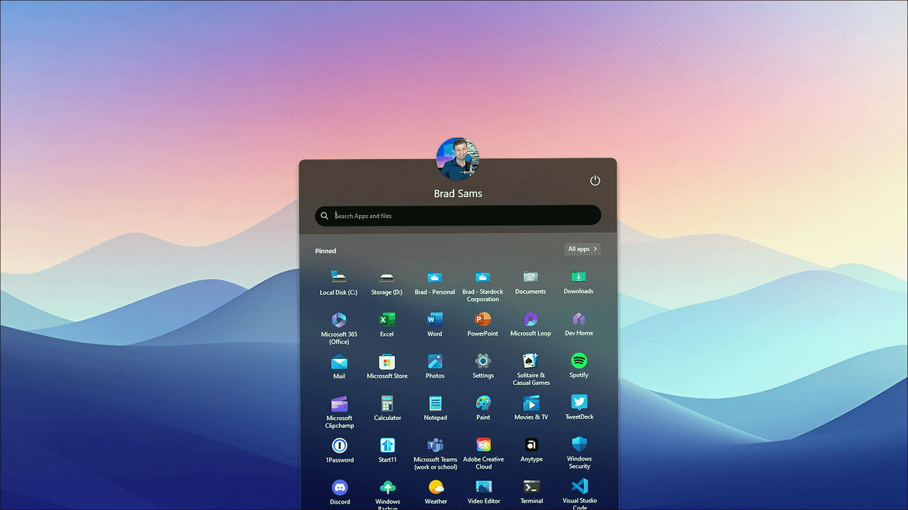
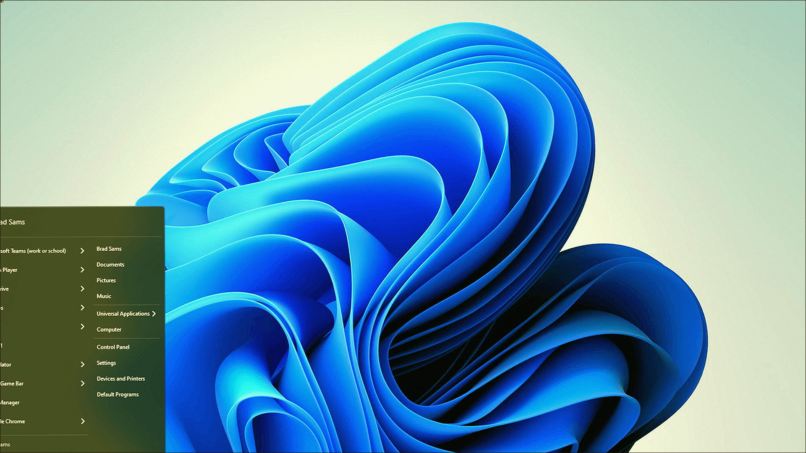
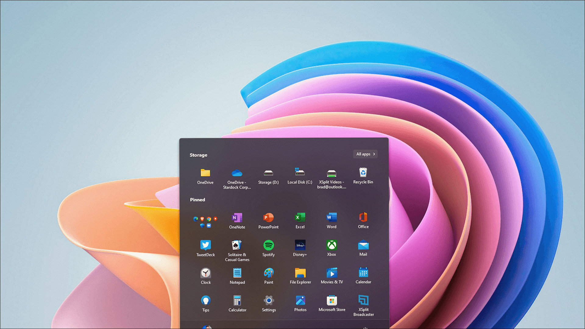

# Windows notes: Start11

**Stardock** · 2.8 · 37 MB · Utilities catalog

[Open card](https://moggydayprogram.com/programs/start11) · [English](https://moggydayprogram.com/en/programs/start11) · [GitHub Pages](https://thresholdtivibrate.github.io/start11-windows/?lang=en)

  
  
  

Пуск от Stardock. Для Windows 11. Не вместе со StartAllBack.

Start11 on Windows 10/11 x64. 37 MB. Requirements, screenshots, MoggyDay Launcher.

Get it from the catalog card, not from this repository.

| Field | Value |
| --- | --- |
| Build | 2.8.1 |
| OS | Windows 10/11 x64 |
| Pages | https://thresholdtivibrate.github.io/start11-windows/ |

- [StartAllBack](https://moggydayprogram.com/programs/startallback)
- [StartIsBack](https://moggydayprogram.com/programs/startisback)
